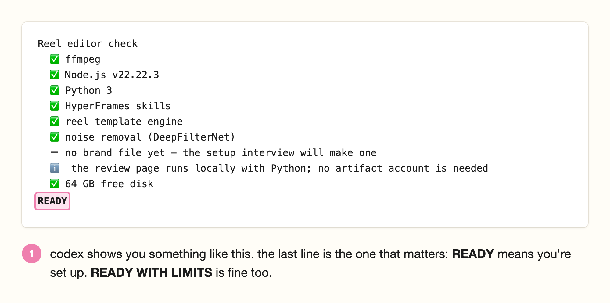

# setup guide (for total beginners)

if you've never opened terminal before, this is for you. setup takes about 20 minutes and you only do it once. after that, editing a reel is giving codex your video and answering a couple of questions.

you'll copy and paste a few commands along the way. you don't need to understand them, i promise. every command on this page has a copy button in its top right corner, so you never have to type one out.

---

## start here

**you'll need:**

- a mac (that's what i've tested on)
- a chatgpt plan that includes codex (plus or higher)
- about 10 GB of free space

**open this guide on your mac,** not your phone. you'll be copying commands from here into your mac, so it's much easier if they're on the same screen.

---

## step 1: get codex

1. codex now lives inside the chatgpt desktop app. go to the [chatgpt desktop app page](https://learn.chatgpt.com/docs/app), click **download for macos**, open the app and sign in with your chatgpt account.
2. in the app, switch to **codex** (not chatgpt).
3. leave it open, you'll come back to it in step 7.

## step 2: download the reel editor

1. on this repo's page on github, click the green **code** button, then **download zip**.
2. open your **downloads** folder and double-click the zip to unzip it. you'll get a folder called `codex-reel-editor-main`.
3. move that folder somewhere you'll find it again, like your **documents** folder.

## step 3: open terminal

terminal is an app that's already on your mac. it's where you type commands.

1. press `cmd + space` to open spotlight search.
2. type `terminal` and press **return**.

a white (or black) window opens with a line ending in `%`. that's the prompt, and it means terminal is ready for a command.


## step 4: install homebrew

homebrew is a free app installer for mac. the video tools come from it.

1. click the copy button on the command below.
2. click inside the terminal window, press `cmd + v` to paste, then press **return**.

```bash
/bin/bash -c "$(curl -fsSL https://raw.githubusercontent.com/Homebrew/install/HEAD/install.sh)"
```

3. it asks for your **password**. this is the password you use to log in to your mac. type it and press **return**. you won't see any letters or dots while you type, that's normal, it's still working.


4. it may ask you to **press return** to continue. press return.
5. now wait. it can take 5 to 10 minutes. it's finished when you see **installation successful** and the `%` prompt comes back on the last line.

already have homebrew? skip to step 6.

## step 5: finish homebrew's setup

take this step slowly. if you skip it, the video tools won't install.

at the end of what homebrew printed, scroll up a little until you find **next steps**. under it are two or three lines that start with `echo` or `eval`. they have your mac's name in them, so they're slightly different for everyone, which is why you copy them from your own terminal and not from here.


1. click and drag over those lines (the ones in the pink box above) to select them.
2. press `cmd + c` to copy.
3. click at the bottom of the terminal window, press `cmd + v` to paste, then press **return**.

nothing much prints, that's fine. when the `%` prompt is back, check it worked by pasting this and pressing **return**:

```bash
brew --version
```

if it prints `Homebrew` and a version number, you're good. if it says `command not found: brew`, close terminal, open it again, and run `brew --version` once more.

## step 6: install the video tools

these are the free tools codex uses to cut video and clean up audio. still in terminal, paste this and press **return**:

```bash
brew install ffmpeg node python
```

this one takes a few minutes and prints a lot. go make a coffee. it's done when the `%` prompt comes back on the last line.

you can close terminal now. you won't need it again for normal editing.

## step 7: set up the reel editor (back in codex)

1. in codex, open a folder and pick the `codex-reel-editor-main` folder from step 2. codex can only see the files in the folder you pick, so make sure it's that one.
2. paste this into the message box and press **return**:

```
Read AGENTS.md and skills/reel-editor/SKILL.md. Set up the reel editor in this project. Use the project's reels folder as REELS_HOME for every command. Run npm ci, install the hyperframes skills (npx skills add heygen-com/hyperframes, choosing codex), then run the doctor check and tell me if anything is missing. Do not upload my footage.
```

codex does the rest. **codex may ask permission to run commands or install tools.** check that what it's asking about relates to this setup (the reel editor, hyperframes, ffmpeg, node, python) before you approve it.

the first setup downloads the animation engine, so it can take a few minutes. at the end it runs a check and shows you a list with ticks. you're done when the last line says **READY**.



**READY WITH LIMITS** is fine too. it means something optional is missing, like the noise remover or capcut, and you can still edit. the ⚠️ lines tell you what you'd gain by adding it.

if any line has a ❌, copy the whole message, paste it back to codex and say "fix this".

## step 8: your first reel

1. film yourself talking to camera on your phone. under 2 minutes is easiest for your first one.
2. airdrop or copy the video to your mac.
3. find the video in finder. hold **option**, right-click it and choose **copy "…" as pathname**. that copies where the file lives.
4. in codex, type **edit this into a reel:** then press `cmd + v` to paste the path. press **return**.
5. **first time only:** codex asks you about your brand, one question at a time (colours, fonts, caption style, sounds, and how tight you want the pacing. natural is the default and keeps your normal pauses). the most useful thing you can give it is a reel you wish you'd made, so have a link ready. this part takes about 5 minutes.
6. codex opens your **reel review** page. it runs on your mac only (the address starts with `http://127.0.0.1`), so your footage never leaves your computer. on the page:
   - press **play rough cut** to watch the edit with your changes as you make them. use −5s / +5s or drag the bar to move around.
   - **cuts:** tap a word to cut it, or tap a crossed-out word to bring it back. grey dotted words are "um"s and ⏸ chips are pauses it removed, tap one to keep it.
   - **graphics:** keep, change (say what) or drop each one. the little picture shows roughly where it sits.
   - **captions:** tap a word to make it a highlight word, tap **edit** to fix spelling, **merge** to join two.
   - **sound & colour:** listen to your voice before and after, and switch off any sound effect you don't like.

   everything saves as you go, and **undo** is there if you change your mind.

   **page won't open?** codex can do the review with you in chat instead. it shows your transcript as numbered lines with the cuts it suggests, then the graphics it plans. reply with the line numbers to keep or cut and what to change, and say yes when you're happy.
7. **make the preview:** click **build preview** on the review page. if you only tapped words and buttons, it builds straight away. if you wrote a change request ("make this graphic pink"), the page tells you to go back to codex and type **build preview** so it can make that change first.

   about 4 minutes later the draft shows up in the **preview** tab of the review page.
8. watch it with the sound on. if something's off, pause there, describe it, and press **add note at current time**. tell codex when you're done and it fixes those spots.
9. when you're happy, type **final** in codex. your full-quality reel (at the resolution you picked in setup) lands in **movies → reels** on your mac. airdrop it to your phone and post.

from your second reel on, it's just steps 8.1 to 8.4, then 8.6 to 8.9. your brand is saved, so every edit already looks like you.

**closed the review page?** the page only works while codex keeps it running. to get it back, type **reopen the review page for my last reel** in codex.

## make a cover (optional)

once your reel is done, click **thumbnail studio** at the top of the review page.

1. pick the footage to use (raw, clean master or final).
2. click **show six frame options**. these are frames sampled evenly through the reel. tap one, or drag the slider to land on the exact frame you want. you pick the expression, it doesn't guess for you.
3. type your headline. press **return** where you want a new line.
4. change the font, size, colour and height, and pick a style: soft shadow, cream title panel or dark fade.
5. leave **show centre crop guides** ticked to check your face and words fit the 3:4 and square crops instagram uses. the guides never show in your downloads.
6. click **save cover settings** so it's all still there next time, then download the size you need: **download portrait PNG** (1080 × 1920, the reel cover), **3:4 crop** (1080 × 1440, your grid) or **square crop** (1080 × 1080).

## want the capcut version too? (optional)

capcut gives you an editable version where every caption and sound effect is its own layer, so you can change those yourself after. the graphics, screenshots and hook title come baked into the video, so change those on the review page before you build.

**check this first:** it doesn't work in the us (capcut's connector isn't available there yet) or india (the capcut app isn't available). everywhere else it usually works. if you're in either place, skip this, you'll still get the full finished reel.

1. make a free account at [capcut.com](https://www.capcut.com).
2. paste this into codex and press **return**:

   ```
   set up the optional capcut route for the reel editor, following references/capcut.md in the skill
   ```

   codex walks you through adding capcut's connector and signing in. if it asks permission, check the request is about capcut before you approve it.

## your sounds

the sound effects that come with this are simple ones made on your mac, not the ones from capcut's library. if you have sound files you're allowed to use, give them to codex and say **use these as my sound effects**. it adds them to your brand. listen to a preview with your voice before you post, and ask codex to turn them down if they're too loud.

## want to know how it works?

read [how it works](BUILD-IT-YOURSELF.md).

## if something goes wrong

| what you see | what to do |
|---|---|
| `command not found: brew` | close terminal and open it again. still broken? redo step 5, copying the next steps lines from your own terminal |
| `command not found: ffmpeg` or `node` | run `brew install ffmpeg node python` again |
| terminal seems frozen after the password | it's working, the letters are hidden on purpose. type your password and press return |
| the check says something is ❌ | paste the whole message into codex and say "fix this" |
| codex can't find the reel editor files | you opened the wrong folder. in codex, open a folder and pick `codex-reel-editor-main` |
| the review page won't load | type **reopen the review page for my last reel** in codex |
| the rough cut won't play | press play rough cut once more (browsers sometimes block the first play). if it still won't, reload the page |
| build preview failed | your last good preview stays on the page. tell codex "the preview build failed" and it reads the error log |
| a sound effect is missing | tell codex. it stops instead of leaving the sound out, so you'll know which file it needs |
| capcut won't connect | if you're in the us or india, that's capcut's region block and there's nothing to fix. anywhere else, ask codex to log you in to capcut again |
| the edit looks off-brand | tell codex what's wrong ("captions are too small", "never use that font"). it adds it to your brand rules so it doesn't happen again |
| your mac is slow or out of space | you need about 10 GB free. 4k needs 35+ GB, so stick to 1080p if your mac is older |

## changing your style later

your brand lives in two files in the **reels** folder inside the project. you never have to open them. tell codex what to change ("make my captions one word at a time", "use pink for highlight words") and it updates them.

your videos, transcripts and renders stay in that reels folder on your mac. they're never added to github.

stuck anywhere? dm me [@getgitgirl](https://instagram.com/getgitgirl), i'm happy to help.
